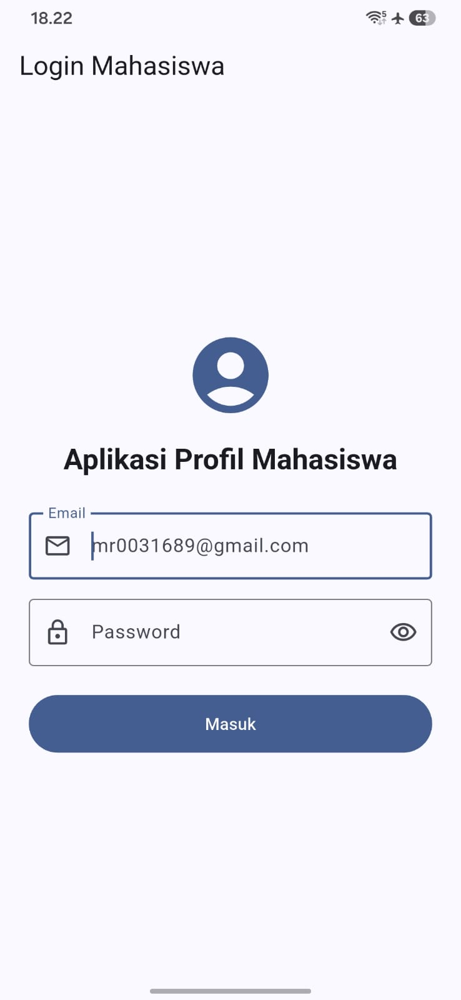
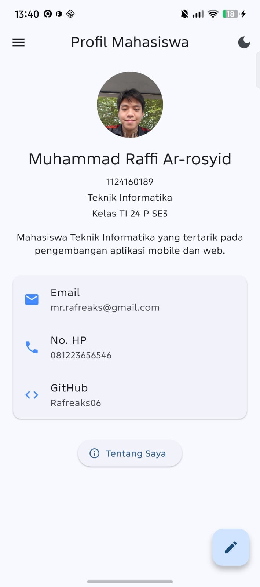
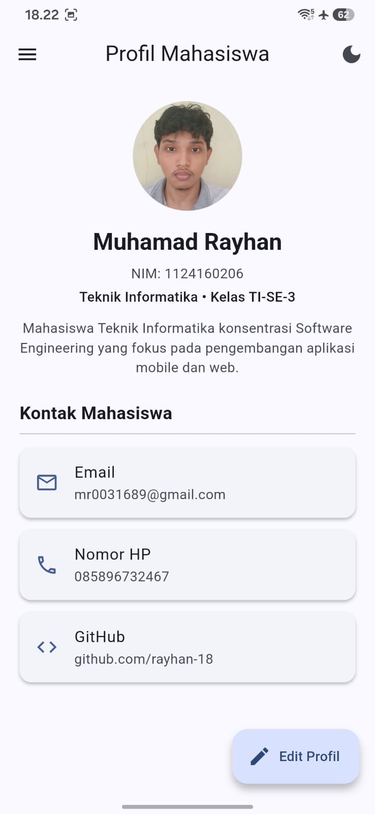
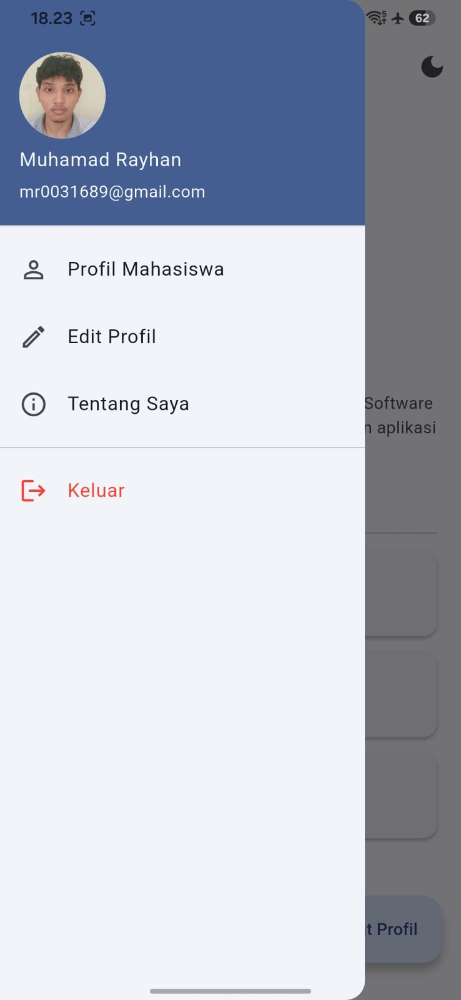

```markdown
# UTS PML - Aplikasi Profil Mahasiswa

**Nama:** Muhamad Rayhan
**NIM:** 1124160206
**Kelas:** TI 24 P SE3
**Mata Kuliah:** Pemrograman Mobile (KB1185)

## Video Presentasi

[UTS PML – Aplikasi Profil – Muhamad Rayhan – 1124160206](https://youtu.be/9thKJgpgxXw)

## Screenshot









## Fitur

- Halaman Login (Form + validator, loading, pushReplacement)
- Halaman Profil (foto dari assets, bio, kontak)
- Halaman Edit Profil (validasi, data kembali via Navigator.pop)
- Halaman Tentang Saya (ListView)
- Mode gelap (switch di drawer dan AppBar)
- Drawer dan FloatingActionButton

## Cara Menjalankan

```bash
flutter pub get
flutter run
```
```
